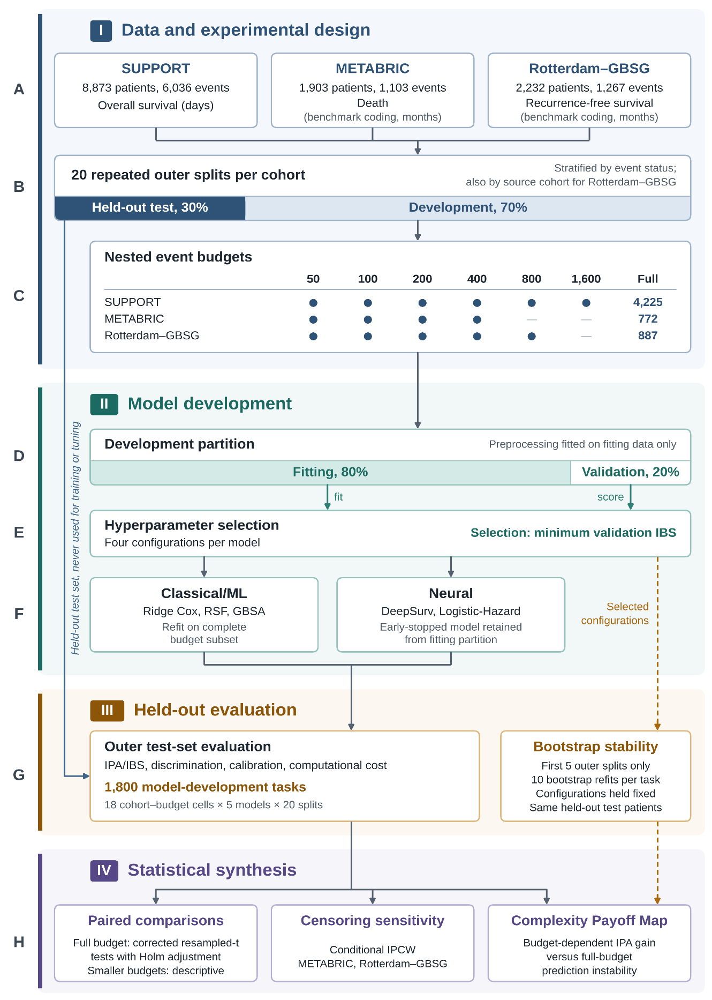
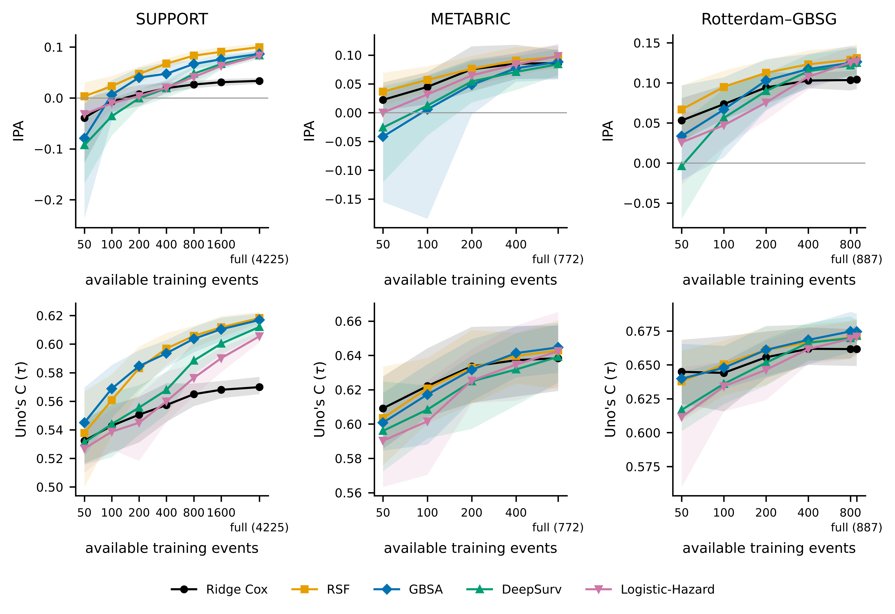
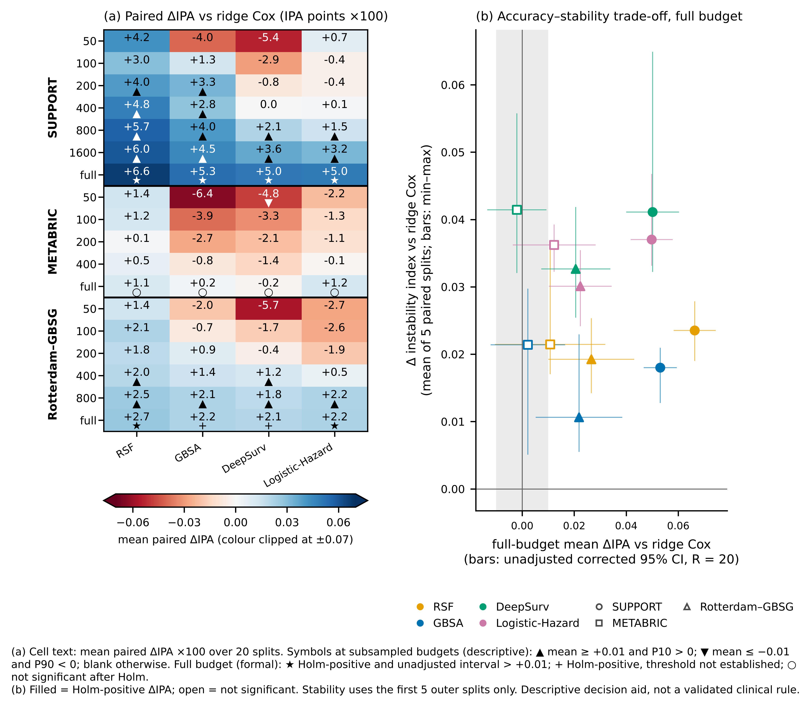
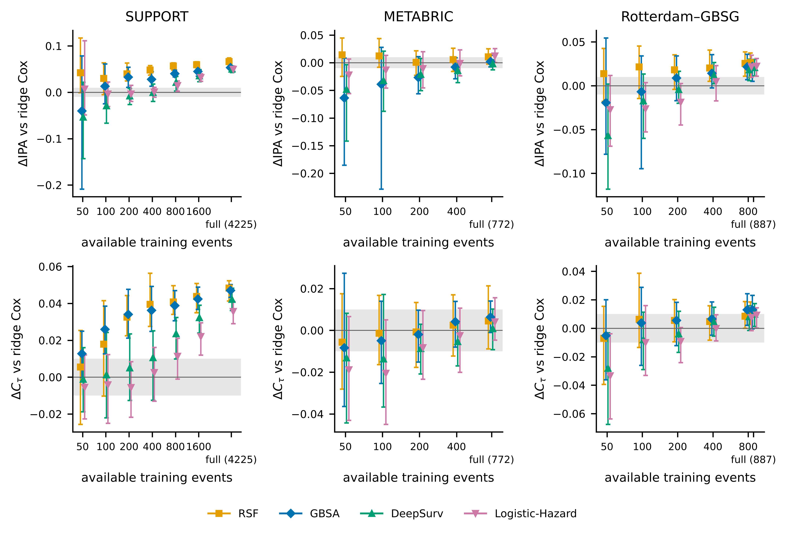

# When Does Model Complexity Pay Off?

**An Event-Budget Analysis of Accuracy, Calibration, and Stability in Clinical Survival Prediction**

Code for the study by Mohamed A. Mahdi and Amgad Muneer. The study asks when flexible survival models (random survival forests, gradient boosting and neural networks) predict better than penalized Cox regression, and how the answer changes with the number of events available for model development.

This is an empirical methodological benchmark. It is **not** a new prediction algorithm and **not** a clinically validated decision tool.

## Study design

<p align="center">
  
</p>

**Scheme 1. Experimental workflow.** Three public cohorts, 20 paired outer splits per cohort, nested event budgets, shared validation-based tuning, held-out evaluation and statistical synthesis.

- **Cohorts** (processed DeepSurv benchmark versions, analysed separately):
  - SUPPORT: 8,873 patients, 6,036 deaths; overall survival in days.
  - METABRIC: 1,903 patients, 1,103 events; death (benchmark coding) in months.
  - Rotterdam–GBSG: 2,232 patients, 1,267 events; recurrence-free survival in months.
- **Models:** ridge-penalized Cox, random survival forest (RSF), gradient-boosted Cox (GBSA), DeepSurv and Logistic-Hazard.
- **Paired design:** 20 stratified 70/30 development–test splits per cohort. Every model and budget in a split is evaluated on the same held-out patients.
- **Event budgets:** nested subsets of each development pool. The ladders are SUPPORT 50–1,600 plus full (4,225 events), METABRIC 50–400 plus full (772), and Rotterdam–GBSG 50–800 plus full (887). In total this gives 18 cohort–budget cells × 5 models × 20 splits = 1,800 model-development tasks.
- **Tuning:** four predefined configurations per model family. All models are selected by integrated Brier score on a shared validation partition (20% of each training subset). Ridge Cox, RSF and GBSA are then refitted on the whole training subset; DeepSurv and Logistic-Hazard keep their early-stopped run.
- **Evaluation:**
  - prediction accuracy: index of prediction accuracy (IPA), from the IPCW integrated Brier score;
  - discrimination: Uno's C at τ and time-dependent AUC at t\*;
  - calibration at t\*: O/E, calibration slope and ICI;
  - bootstrap prediction instability: first five splits, 10 refits per task;
  - computational cost;
  - a conditional-IPCW sensitivity analysis for METABRIC and Rotterdam–GBSG.
- **Inference:** at the full budget, corrected resampled-t intervals (Nadeau–Bengio), with Holm adjustment across the four comparisons with ridge Cox in each cohort–metric cell. Comparisons at subsampled budgets are descriptive only: means, 10th–90th percentiles and win rates across splits.

`FULL_STUDY_PROTOCOL.md` gives the frozen protocol. `DATA_PROVENANCE.md` documents data sources, checksums, units, endpoints and the censoring assumptions.

## Key findings

ΔIPA and ΔC are mean paired differences from ridge Cox (alternative minus ridge Cox) over the 20 splits. Values are as reported in the manuscript (Table 2, Sections 3.3–3.8) and Supplementary Tables S8, S9, S12–S14.

- **Full budget, IPA (formal inference):**
  - SUPPORT: all four alternatives improved IPA after Holm adjustment (ΔIPA +0.050 to +0.066).
  - Rotterdam–GBSG: all four improved IPA after Holm adjustment (ΔIPA +0.021 to +0.027). Only for RSF and Logistic-Hazard did the unadjusted corrected interval lie entirely above the prespecified +0.01 practical threshold.
  - METABRIC: no alternative differed significantly from ridge Cox (ΔIPA −0.002 to +0.012).
- **Small budgets, IPA (50–200 events, descriptive):** the boosted and neural models had lower mean IPA than ridge Cox in 23 of 27 comparisons: GBSA 6 of 9, DeepSurv 9 of 9 and Logistic-Hazard 8 of 9. RSF had a positive mean difference in all 9.
- **Discrimination at full budget:** Uno's C improved after Holm adjustment only in SUPPORT (ΔC +0.036 to +0.048).
- **Calibration at full budget:** no difference from ridge Cox in ICI or calibration-slope deviation was significant after Holm adjustment in any cohort.
- **Stability (first five splits, descriptive):** at the full budget every alternative had a higher mean bootstrap instability index than ridge Cox in every cohort: 0.034–0.067 against 0.016–0.026.
- **Cost:** summed over all tasks on the study hardware (CPU for the classical models, GPU for the neural models), task wall time was 9.49 h: 0.08 h for ridge Cox, against 0.65 h (Logistic-Hazard), 0.81 h (DeepSurv), 1.36 h (RSF) and 6.60 h (GBSA). At the full SUPPORT budget, the median tuning-plus-final-fit time per task was 1.3 s for ridge Cox and 476.6 s for GBSA.
- **Censoring sensitivity** (METABRIC and Rotterdam–GBSG): conditional IPCW left the practical classification unchanged in 41 of 44 IPA comparisons and changed paired ΔIPA by at most 0.0053. One change matters for the full-budget results: Logistic-Hazard's interval in Rotterdam–GBSG fell just below the +0.01 threshold (lower bound 0.0102 → 0.0097), so its threshold status is not robust to the weighting.

The benefit of flexible models therefore depended on the cohort and the event budget. Any accuracy gain should be weighed against calibration, prediction stability and computational cost.

## Figures

<p align="center">
  
</p>

**Figure 2. Learning curves.** Mean held-out IPA (top) and Uno's C at τ (bottom) against the number of available training events, for each model and cohort. Shaded bands show the 10th–90th percentiles across the 20 splits.

<p align="center">
  
</p>

**Figure 8. Complexity Payoff Map.**
- **(a)** Mean paired ΔIPA from ridge Cox (×100) for every cohort–budget cell. At subsampled budgets the symbols summarize descriptive consistency; at the full budget they show Holm-adjusted inference.
- **(b)** Full-budget accuracy–stability trade-off: mean ΔIPA (unadjusted corrected 95% interval) against the mean paired difference in instability index from ridge Cox (bars: minimum–maximum over the five stability splits).

The map is a descriptive decision aid, not a validated clinical rule.

<details>
<summary><b>Figure 3. Paired performance differences from ridge Cox</b></summary>
<p align="center">
  
</p>

Paired ΔIPA (top) and ΔUno's C at τ (bottom) for each alternative model, plotted against available training events. Points are means over 20 splits. Error bars are descriptive 10th–90th percentile ranges across splits at every budget, including the full budget; they are not confidence intervals. The grey band marks the ±0.01 practical threshold. Formal full-budget intervals are in Table 2 of the manuscript.
</details>

## Installation

```bash
git clone https://github.com/amgad-muneer/event-budget-survival-prediction.git
cd event-budget-survival-prediction
python -m venv .venv && source .venv/bin/activate
pip install -r requirements.txt
```

`requirements.txt` pins the newer environment in which this repository was verified (Python 3.13, Linux, CPU); see [Reproducibility status](#reproducibility-status).

The original study environment is documented in Supplementary Section S8: Python 3.10.16, NumPy 2.2.6, pandas 2.2.3, SciPy 1.15.3, scikit-learn 1.6.1, scikit-survival 0.25.0, lifelines 0.30.0, PyCox 0.3.0, torchtuples 0.2.2, PyTorch 2.14.1+cu126 (CUDA runtime 12.6), Matplotlib 3.10.3 and PyYAML 6.0.2. That list covers the main packages only; no complete lockfile of the original environment is available. A GPU is optional. The pilot runs on a CPU; the full study was run with CPU workers for the classical models and GPU workers for the neural models.

## Data preparation

No data are stored in this repository. `download_data.py` handles the public benchmark files:
1. It downloads the three original DeepSurv HDF5 files.
2. It verifies their SHA-256 checksums and record and event counts against `DATA_PROVENANCE.md`.
3. It writes `data/support.csv`, `data/metabric.csv` and `data/gbsg.csv`. Each file has covariates `x0, x1, …`, `duration` and `event`, in train-then-test order, as in pycox.

```bash
python download_data.py
```

## Reproducing the analysis

**1. Data audit and frozen design (about 2 minutes).**

```bash
python stage0_audit.py --data-dir data --out-root outputs   # audit and manifests
python validate_metrics.py                                  # metric checks on synthetic data
python recover_gbsg_cohort.py                               # verify Rotterdam/GBSG cohort membership
python freeze_design.py                                     # horizons, tau and event budgets
```

**2. Lightweight verification run (pilot; minutes on a CPU).** One split, budgets 50, 200 and full, all five models with one fixed configuration each, in all three cohorts. It checks that the pipeline runs end to end. It does not reproduce the paper's results.

```bash
python run_pilot.py --device cpu
python estimate_feasibility.py                              # projected full-study runtime
python make_report.py                                       # outputs/STAGE0_PILOT_REPORT.md
```

**3. Full study (compute-intensive: 1,800 tasks, 12,780 model fits).**

```bash
python run_full_study.py --n-reps 20 --prepare                                    # splits and run plan
python run_full_study.py --n-reps 20 --worker cpu --worker-id cpu0                 # Cox, RSF, GBSA
python run_full_study.py --n-reps 20 --worker gpu --worker-id gpu0 --device cuda:0 # DeepSurv, Logistic-Hazard
python run_full_study.py --n-reps 20 --collect
python analyze_full_study.py --n-reps 20                                          # tables and figures
python generate_FigureS3_publication_ready.py                                     # Supplementary Figure S3
```

Workers claim tasks through lock files, so several CPU and GPU workers can run in parallel. Every finished task is checkpointed: rerunning a worker skips completed tasks, and extending from 5 to 20 repetitions runs only the new ones. The analysis runs only when every expected task is valid; otherwise it writes a diagnostic report. Results are written to `outputs/full/`.

## Repository structure

```
├── download_data.py              # download and verify the DeepSurv data; build data/*.csv
├── stage0_audit.py               # environment, schema and follow-up audit
├── validate_metrics.py           # synthetic-data validation of the metric pipeline
├── recover_gbsg_cohort.py        # Rotterdam/GBSG cohort membership by value matching
├── freeze_design.py              # frozen horizons, tau and event-budget ladders
├── common.py                     # data loading, splits, preprocessing, metrics, IPCW
├── models.py                     # the five model families behind one interface
├── run_pilot.py                  # pilot (one split, fixed configurations)
├── estimate_feasibility.py       # runtime projection from pilot timings
├── make_report.py                # Stage 0 and pilot report
├── run_full_study.py             # full study: splits, tuning, evaluation, stability, checkpoints
├── analyze_full_study.py         # statistical analysis, tables and figures
├── generate_FigureS3_publication_ready.py  # Supplementary Figure S3
├── pilot_config.yaml             # data, horizons, models, thresholds
├── full_study_config.yaml        # tuning grids, stability, sensitivity, analysis settings
├── FULL_STUDY_PROTOCOL.md        # frozen study protocol
├── DATA_PROVENANCE.md            # sources, checksums, units, endpoints, censoring assumptions
├── VERIFICATION.md               # verification commands and outcomes for this release
├── requirements.txt              # pinned verification environment
├── CITATION.cff, LICENSE         # citation metadata and MIT license
└── figures/                      # publication figures shown in this README
```

## Reproducibility status

The repository was verified on a CPU in the pinned environment; [`VERIFICATION.md`](VERIFICATION.md) lists the commands and outcomes.

- **Pipeline validation, end to end on a fresh clone:**
  - data download with checksum verification;
  - Stage 0 audit and the synthetic metric-validation checks;
  - Rotterdam–GBSG cohort recovery and frozen-design generation;
  - the pilot (all five models in all three cohorts);
  - a bounded full-study integration test of preparation, interrupted and resumed workers, collection and analysis.
- **Partial numerical reproduction:** the regenerated splits match the original study exactly. Rerunning all 360 ridge Cox tasks (all cohorts, 20 splits) and all 120 RSF tasks in Rotterdam–GBSG reproduced the archived performance and stability results to floating-point precision. A CPU rerun of DeepSurv in Rotterdam–GBSG, which originally ran on GPUs, agreed closely but not exactly: cell-mean IPA within 0.004 and Uno's C within 0.001.
- **Not verified:** the remaining models and cohorts were not rerun, so the complete set of 1,800 tasks has not been independently reproduced. The verification environment is newer than the original one (Supplementary Section S8), and the original neural models were trained on GPUs. Neural results are not expected to be bit-identical across hardware or library versions.

## Data availability and limitations

The processed benchmark data are publicly available from the [DeepSurv repository](https://github.com/jaredleekatzman/DeepSurv/tree/master/experiments/data) (Katzman et al., 2018, *BMC Medical Research Methodology* 18:24) and via [pycox](https://github.com/havakv/pycox). Please cite the original studies when using them.

- **METABRIC:** the processed data contain a death indicator without a verified cause-of-death label. The endpoint is therefore reported as "death (benchmark coding)", not as verified overall or disease-specific survival.
- **Rotterdam–GBSG:** this cohort pools two populations with different follow-up. Rotterdam is truncated at 84 months and GBSG runs to 87 months, so part of the censoring is administrative and cohort-related. Cohort membership is used only to stratify splits and in the censoring model.
- **Censoring:** marginal IPCW assumes covariate-independent censoring. The conditional-IPCW analysis addresses this for IBS, IPA and Brier score only, not for discrimination.
- **Stability:** instability is conditional on the selected hyperparameters and uses only the first five splits.
- **Inference:** formal inference is limited to the full budget. Subsampled-budget comparisons are descriptive.

## Citation and license

If you use this code, please cite the paper. Publication details will be added on acceptance. Machine-readable metadata is in [`CITATION.cff`](CITATION.cff).

> Mahdi MA, Muneer A. When Does Model Complexity Pay Off? An Event-Budget Analysis of Accuracy, Calibration, and Stability in Clinical Survival Prediction. Manuscript.

The code is released under the [MIT License](LICENSE). The datasets are subject to the terms of their original sources.
